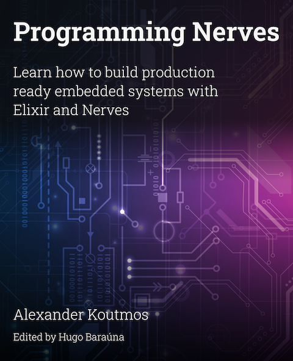
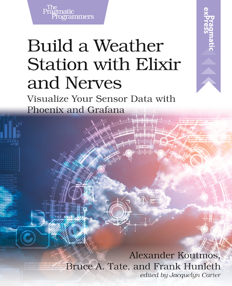

# LiveViewSecure

Tamper-proof `phx-click`, `JS.push` and hidden form values for Phoenix LiveView.

Anyone can send any event with any params over the LiveView websocket. Hiding
the delete button doesn't stop someone from pushing `"delete_user"` with
whatever id they want. LiveViewSecure signs each event together with its values
when you render it, and rejects any declared event whose params don't match a
signature that the receiving LiveView issued.

```elixir
defmodule MyAppWeb.UsersLive do
  use MyAppWeb, :live_view
  import LiveViewSecure.HTML

  on_mount {LiveViewSecure, events: ["delete_user", "archive", {"save", unsigned: ["post"]}]}

  def render(assigns) do
    ~H"""
    <div :for={user <- @users}>
      {user.name}
      <button :if={@can_delete} {signed_attrs(@live_view_secure, "delete_user", id: user.id)}>
        Delete
      </button>
      <button phx-click={signed_push(@live_view_secure, "archive", value: %{id: user.id, scope: "mine"})}>
        Archive
      </button>
    </div>

    <.form for={@form} phx-change="validate" phx-submit="save">
      <.signed_inputs secure={@live_view_secure} event="save" values={%{id: @post.id}} />
      <.input field={@form[:title]} />
    </.form>
    """
  end

  # Handlers don't change. Signed values arrive as strings, next to a "__sig" param.
  def handle_event("delete_user", %{"id" => id}, socket), do: ...
end
```

## Installation

Add `live_view_secure` to your dependencies in `mix.exs`:

```elixir
def deps do
  [
    {:live_view_secure, "~> 0.1.0"}
  ]
end
```

It needs Phoenix LiveView 1.1.34, 1.2.14 or later, and Elixir 1.18 or later.
Those LiveView releases fix
[CVE-2026-126334](https://github.com/phoenixframework/phoenix_live_view/security/advisories/GHSA-v4p7-3pm2-wq6c),
which let a hand-crafted join skip a `live_session`'s `on_mount` hooks, your
own included.

## Level Up Your Elixir Skills!

Everything I have learned building production Elixir systems ends up in one of
two places: an open source library on [Hex](https://hex.pm/users/akoutmos), or a
book. The libraries are free and will stay that way. The books are what let me
keep writing them.

If this library has been useful to you, picking up one of my books is the best
way to support this library and the many others that I maintain. You'll also
gain knowledge that took me years to attain!

<p align="center">
  <a target="_blank" href="https://financialelixir.dev"></a>
  <a target="_blank" href="https://elixirpatterns.dev"></a>
  <a target="_blank" href="https://programmingnerves.dev"></a>
  <a target="_blank" href="https://pragprog.com/titles/passweather/build-a-weather-station-with-elixir-and-nerves"></a>
</p>

**[Elixir For Finance](https://www.financialelixir.dev)** — Learn how to
navigate markets and trading without leaving the BEAM. Livebook for exploration,
Explorer for dataframes, VegaLite for visualizations. This book goes through it
all!

**[Elixir Patterns](https://elixirpatterns.dev)** — The essential BEAM handbook
for the busy developer. The patterns and mental models covered in this book
teach you how to build scalable systems that can handle whatever production
throw at them.

**[Programming Nerves](https://www.programmingnerves.dev/)** — The best place to
start if you are looking to get your own hardware projects up and running with
Elixir and Nerves. I doubt you'll find a more fun and enjoyable hardware book
out there!

**[Build a Weather Station with Elixir and Nerves](https://pragprog.com/titles/passweather/build-a-weather-station-with-elixir-and-nerves/)**
— A project-based introduction to Nerves. Wire up the sensors, capture readings
and then pipe the data into a time series database that can be visualized with
Grafana.

## Setup

Attach the default logger when your application starts. It logs rejections,
and warns about signed events that reach a handler unverified:

```elixir
# lib/my_app/application.ex
def start(_type, _args) do
  :ok = LiveViewSecure.Telemetry.attach_default_logger()
  # ...
end
```

Then `import LiveViewSecure.HTML` wherever you import your other HTML helpers
(`html_helpers/0` in `MyAppWeb`).

## What it guarantees, and what it doesn't

For every event you declare, LiveViewSecure guarantees that the event name and
every signed value are exactly what this LiveView (or LiveComponent) rendered
together on one element since its last key rotation. No value was changed,
swapped in from another element or event, added or removed.

It does **not** guarantee that the user is still allowed to do the thing.
A signature means "this was on the page", not "this is authorized now". Keep
authorizing in your contexts, as the [LiveView security
guide](https://hexdocs.pm/phoenix_live_view/security-model.html) says. This
library is defense in depth. It's most useful where the server no longer holds
what it rendered (streams, `temporary_assigns`), so there's nothing to check an
incoming id against.

It also doesn't cover anything that isn't an event: URL params in
`handle_params/3`, upload progress callbacks, and events of LiveViews or
components that don't use it.

## How it works

* **One token per element.** `__sig` is an HMAC-SHA256, truncated to 128 bits,
  over the event name and the sorted key/value pairs. They're length-prefixed,
  so no two different payloads share an encoding. The token also lists which
  keys it covers (`"id,scope.<mac>"`), so signed params that are dropped, and
  unsigned params that are added, are both caught.
* **A random root key per LiveView process.** It's created on mount and kept in
  an `:atomics` array, never in an assign. The `@live_view_secure` context only
  holds a random id, and signs with `HMAC(root, id)`, so no key material can
  leak through `inspect`, crash reports or serialization. Tokens from another
  tab, another user, an earlier connection or a saved copy of the page don't
  verify, and there's no secret to configure.
* **Verified in an `attach_hook(:handle_event)`, first.** The hook runs before
  your `handle_event/3`, and before any other `:handle_event` hook, including
  ones attached earlier. (A hook that later moves itself to the front would run
  first; don't detach `:live_view_secure`.) It can only let an event through or stop it, never
  rewrite it. That's why the signature travels next to the values instead of
  being wrapped around them, and why your handlers stay unchanged.
* **Fails closed both ways.** If a template forgets to sign a declared event,
  the event is rejected. If a template signs an event that isn't declared, the
  helper raises when it renders, instead of shipping an event that looks
  protected but isn't.

**Declare `on_mount {LiveViewSecure, ...}` in the LiveView module.** Putting it
in the `live_view` block of your `MyAppWeb` module counts as the module, and so
does calling `LiveViewSecure.attach/2` from `mount/3`. A `live_session`'s
`on_mount` works too, but LiveView only runs it for LiveViews mounted through
one of that session's routes, not for nested ones (`live_render`) or ones
rendered from a controller. Hooks in the module run however the LiveView is
mounted, and the event list sits next to the `handle_event/3` clauses it covers.
Declare it in one place only: attaching twice to the same LiveView raises.

## Options

```elixir
on_mount {LiveViewSecure,
          events: ["delete_user", {"search", unsigned: ["value"]}, {"transfer", single_use: true}],
          on_failure: :raise}

on_mount {LiveViewSecure, events: :all, except: ["validate"]}
on_mount {LiveViewSecure, events: [:all, {"save", unsigned: ["post"]}], except: ["validate"]}
```

* `:events` (required) takes one of three forms:
  * a list of event names, each optionally given as `{name, opts}`;
  * `:all`, which verifies every event except those in `:except`;
  * `[:all, {name, opts}, ...]`, which verifies every event and sets options
    for the ones listed.

  `:all` is the safest posture. A new event is protected the moment you add
  it, instead of when someone remembers to declare it. List in `:except`
  anything that can't carry a signature:
  * events your JS hooks push with `pushEvent`;
  * events handled by `:handle_event` hooks from a `live_session`, since
    verification now runs before them;
  * form `phx-change` validation.
* `:except` only applies to `:all`. It lists events that don't need a
  signature, typically `phx-change` validation.
* `:unsigned` sets what to do with params that arrive without being signed.
  It can be set per event.
  * `:deny` (default) rejects them. The one exception is the element's empty
    DOM value, which browsers send with every click: `"value" => ""` from a
    `<button>` and `"value" => 0` from an `<li>`. Since anyone can add that
    exception to any event, treat a missing `value` and an empty one the same.
  * A list of param names lets just those through. For example, `["key"]` for
    key events, `["value"]` for `phx-blur` on an input, or `["post"]` for a
    form built with `to_form(changeset)`, whose fields are all nested under
    `"post"`.
  * `:allow` lets anything through. It requires `:signed`.
* `:signed` lists params that must be covered by the signature whenever they
  arrive, whatever `:unsigned` allows. It can be set per event. It's required
  with `unsigned: :allow`. Without it, a token this LiveView issued for the same
  event with fewer values (say, a "new" form next to an "edit" form) would
  verify, and the client could add `"id"` itself. For the same reason, a
  template that signs a key the event's policy would also accept unsigned (not
  in `:signed` under `:allow`, or listed in `:unsigned`) raises when it renders.
* `:single_use` (per event, default `false`) accepts each rendered token for
  the event once. See [Replay](#replay).
* `:on_failure` sets what happens on a rejection. `:raise` (default) raises
  `LiveViewSecure.InvalidEventError`, which crashes the LiveView, and the client
  remounts it. `:halt` drops the event and keeps the LiveView running. Either
  way the handler never runs.

## Forms

```elixir
on_mount {LiveViewSecure, events: [{"save", unsigned: ["post"]}]}

<.form for={@form} phx-change="validate" phx-submit="save">
  <.signed_inputs secure={@live_view_secure} event="save" values={%{id: @post.id}} />
  <.input field={@form[:title]} />
</.form>
```

* **The signature covers the hidden inputs, not what the user typed.** Treat
  every unsigned field as user input, and cast it with a changeset as usual.
* **The submit button's `name`/`value` is user input too.** Don't let a
  "Publish" button's `name="action" value="publish"` grant anything. Give each
  privileged action its own form and event.
* **Check that `phx-submit` matches the `event` you sign for.** If the form
  submits `"save_post"` while the inputs are signed for `"save"`, the submit is
  an undeclared event and goes through unverified. The default logger warns
  when a signed event reaches a handler unverified, so watch for that warning
  in development. `events: :all` rules it out.
* **`phx-change` carries the hidden inputs and `__sig` as well.** A token is
  bound to one event, so leave validation undeclared, or in `:except`.
  Validation shouldn't have side effects anyway.

## Replay

**A token stays valid until the key rotates or the LiveView process ends.** A
user can resend any declared event and values this LiveView has rendered, even
after the button is gone. Only the same user in the same tab can do this, but
for one-shot actions it matters. Pick one of these:

* Make handlers idempotent and re-check state, which you should do anyway. For
  example, approving an already-approved request does nothing.
* Call `LiveViewSecure.rotate/1` in the handler.
* Mark the event `single_use: true`. Each rendered token is accepted once:
  - **Before your handler runs**, the token for that exact event and values is
    re-issued.
  - **A replay or a double click** arrives as `:revoked` and is dropped, never
    raised.
  - **The button, if it's still on the page**, re-renders with a fresh token
    that works once more.
  - **Every other element keeps its token**, including other rows, stream
    items and clicks in flight.

`single_use` is per LiveView process. It isn't a server-side idempotency key,
because another tab renders its own token. For "at most once, ever", enforce it
in your data layer.

Accepting a `single_use` event, like calling `rotate/1`, re-renders every
expression that signs with that context. That's roughly 100 bytes per signed
element, so 1,000 signed rows cost about 200 KB per accepted event. Use it for
low-volume, high-stakes actions like transfers, approvals and redemptions. For
actions inside large lists, use idempotent handlers, or one LiveComponent per
row, since a component only re-renders itself.

## Revoking tokens

```elixir
def handle_info({:permissions_changed, user}, socket) do
  {:noreply, socket |> assign(current_user: user) |> LiveViewSecure.rotate()}
end
```

`rotate/1` on a LiveView replaces its process's root key, which revokes every
token the LiveView and its components have issued. Every signing expression
that uses `@live_view_secure` re-renders with fresh tokens. Each component
re-renders on its next event, however many rotations ago its tokens were
issued, and that first event is dropped. On a component's socket, `rotate/1`
only revokes that component's tokens.

**Tokens from just before a rotation are reported as `:revoked`**, and they're
always dropped, never raised: a click that was in flight during the rotation
looks exactly the same.

* **Only an untampered payload counts.** A revoked token carrying params it
  didn't sign is reported as tampering.
* **Older tokens are `:invalid_signature`.** That includes a click in flight
  across two rotations in quick succession, so if you rotate often, consider
  `on_failure: :halt`.

Anything LiveView doesn't re-render keeps its old tokens, which then fail
closed:

* **Stream items** keep them until you re-insert them, e.g.
  `stream(socket, :items, items, reset: true)`.
* **`temporary_assigns`:** a comprehension over a temporary assign
  re-renders when the key rotates, or a `single_use` event is accepted, but by
  then the list is empty, so its rows disappear. Re-assign the list in the same
  callback, or use a stream.
* **`phx-update="ignore"` regions** never work: their content keeps the tokens
  from the first (disconnected) render, which no live process can verify.
  Don't put signed elements in them.
* **Attributes you compute once** keep the key they were signed with, e.g.
  signed attrs precomputed into another assign in `mount/3`. Sign in the
  template.

## LiveComponents

A LiveView's hooks never see events sent to a component (`phx-target={@myself}`),
because components have their own lifecycle. Attach in the component:

```elixir
def mount(socket) do
  {:ok, LiveViewSecure.attach(socket, events: ["remove_item"])}
end

# in the component's template
<button {signed_attrs(@live_view_secure, "remove_item", [id: item.id], target: @myself)}>
```

* **Each component gets its own context.** Don't pass the parent's
  `@live_view_secure` into a component: it would replace the component's own,
  and every event the component receives is then rejected with
  `:foreign_context`.
* **Pass `target: @myself` to the helpers** rather than writing `phx-target`
  separately. Then the helper can tell when a component is signing with its
  parent's context and never attached, and raise instead of rendering events
  nobody verifies. With a separate `phx-target` attribute it can't.

## Nested LiveViews

A nested LiveView (`live_render`) is its own process with its own root key.
It needs its own `on_mount` in its module, since neither its parent's nor a
`live_session`'s applies to it. A context only works in the process that
created it, so handing one to a child, through its session or `assign_new/3`,
raises.

## Telemetry and logging

| Event | When | Measurements | Notable metadata |
| --- | --- | --- | --- |
| `[:live_view_secure, :verify, :start \| :stop \| :exception]` | Around verification of every declared event | `duration` on `:stop` | `view`, `source`, `event`, and on `:stop`: `result`, `reason`, `reason_type` |
| `[:live_view_secure, :event, :rejected]` | A declared event failed verification | `count: 1` | `view`, `source`, `event`, `reason`, `reason_type`, `action` |
| `[:live_view_secure, :event, :unverified]` | An undeclared event passed through | `count: 1` | `view`, `source`, `event`, `signed` |
| `[:live_view_secure, :key, :rotate]` | `rotate/1` replaced a key | `count: 1` | `view`, `source` |

* **Common metadata.** All events also carry the `socket`. `source` is `:view`
  or `:component`. `action` is what happened, `:raise` or `:halt`.
* **`reason_type`** is one of `:missing_signature`, `:malformed_signature`,
  `:invalid_signature`, `:revoked`, `:missing_params`, `:unsigned_params`,
  `:foreign_context` or `:no_context`.
* **`:revoked` is normal in small numbers**: in-flight clicks during a
  rotation, and double clicks on single-use events. A burst of any other reason
  from one user means someone is probing your events.
* **`:exception`** only fires if verification itself crashes, which would be a
  bug. Rejections are not exceptions.
* **`:unverified` with `signed: true`** means a signed event reached a handler
  without being verified. It could be:
  * a typo in `:events`;
  * a `phx-submit` that doesn't match `<.signed_inputs>`;
  * a LiveComponent that never called `attach/2`;
  * a nested LiveView without its own `on_mount`.

  LiveViews and components with no hook at all are watched through Phoenix's
  own telemetry when the default logger is attached. Form `phx-change` events
  are left out, because they normally carry the form's signed inputs.

```elixir
# MyAppWeb.Telemetry
counter("live_view_secure.event.rejected.count", tags: [:view, :reason_type]),
counter("live_view_secure.event.unverified.count", tags: [:view, :signed]),
counter("live_view_secure.key.rotate.count", tags: [:view]),
distribution("live_view_secure.verify.stop.duration", unit: {:native, :microsecond}, tags: [:result])
```

**Don't tag metrics by `event` as-is.** The event name comes from the client,
so with `events: :all`, or on `:unverified`, an attacker can create unlimited
tag values. Every other field in the table is bounded.

The default logger (see [Setup](#setup)) writes one `:warning` line per
rejection, and one per `:unverified` event with `signed: true`, with the
client's values escaped and truncated. Pass `level:` to change the level, e.g.
`attach_default_logger(level: :error)`.

## Production checklist

* **Attach the default logger** in your `Application.start/2`.
* **Declare `on_mount {LiveViewSecure, ...}` in each LiveView module**, or in
  your `MyAppWeb` `live_view` block, and in each nested LiveView. Call `attach/2`
  in each LiveComponent that handles events.
* **Prefer `events: :all`**, with `:except` for validation-only events.
* **For forms, use a list policy** (`unsigned: ["post"]`). Use
  `unsigned: :allow` only with an exact `:signed` list.
* **Make one-shot handlers idempotent**, or use `single_use: true`.
* **Call `rotate/1` when a user's permissions change.**
* **Keep authorizing in your contexts.**
* **Cap websocket frame sizes on your endpoint**, e.g.
  `socket "/live", Phoenix.LiveView.Socket, websocket: [max_frame_size: 1_000_000]`.
  Verification is linear in payload size, but nothing else bounds what a
  client sends.
* **Wire the telemetry into metrics and alerting**, especially `:rejected` by
  `reason_type`.
* **With the default `on_failure: :raise`, any client can crash and remount its
  own LiveView at will.** That's no worse than a handler with no matching
  clause, but if `mount/3` is expensive, consider `:halt`.

## Limits and sharp edges

* **Values are strings.** They're converted with `to_string/1`. Sign ids, not
  structs.
  * `nil` and `false` leave the param out, like plain `phx-value-*` does. A
    client can't add it back: it's either rejected as unsigned, or required to
    be signed by `:signed`.
  * `true`, maps, lists and tuples raise.
* **HTML normalizes some characters, so signed values do too.** For
  `signed_attrs` and `signed_inputs`, CR and CRLF become LF, and NUL becomes
  U+FFFD, the same way the browser's HTML parser changes them. `signed_push`
  values travel as JSON and arrive unchanged.
* **Keys for `signed_attrs/4` must be lowercase**, because browsers lowercase
  attribute names, and **can't be `value`**, because LiveView overwrites it with
  the element's DOM value. `signed_push/3` has neither restriction.
* **`:binding` is limited to LiveView's event bindings** (`phx-click`,
  `phx-blur`, `phx-keydown`, and so on). Viewport bindings aren't included,
  since the client sends its own `id` with them. Inside other JS commands, use
  `signed_push/3`. For forms, use `<.signed_inputs>`. A `phx-change` binding
  only reads `phx-value-*` from the `<form>` itself.
* **Assumes the default `phx-` binding prefix.**

## Known limitations

These are covered by tests that are skipped or excluded, which assert the
secure behavior the library can't provide. Run them with
`mix test --include skip --include known_limitation`.

* **Default replay.** Tokens are reusable until rotation. See [Replay](#replay).
* **A LiveComponent that never calls `attach/2` verifies nothing.** That's
  true even if the parent uses `events: :all`, because component events skip
  the LiveView's hooks. With `target: @myself` passed to the helper it's caught
  at render. With a separate `phx-target` attribute it's only reported, as
  `:unverified` with `signed: true`.
* **A click in flight across two rotations in quick succession** isn't
  recognized as `:revoked`, so `on_failure` applies.
* **The submit button's `name`/`value` is user input.** See [Forms](#forms).

See [SECURITY.md](SECURITY.md) for the threat model and the security review.

## Changes from the 2021 proof of concept

| PoC | Now |
| --- | --- |
| Event and each value signed separately, so they could be mixed and matched across rows and events | One MAC over the event and all its values |
| Signed params could be dropped, and handlers fell back to defaults | The key list is signed; missing keys are rejected |
| Hardcoded key, bound to `socket.id` (shared by nested LiveViews with a fixed `id:`) | Random per-process root key, held outside the assigns |
| Rejected every browser `<button>` click (`"value" => ""` wasn't signed) | The empty DOM value is allowed; anything else unsigned is rejected |
| Values containing `\n` failed the regex | Length-prefixed encoding, no regex |
| `secure_handle_event` macro with an anonymous-fn handler | `on_mount` + `attach_hook`, ordinary `handle_event/3` clauses |
| `phx-click` only | Any event binding, `JS.push`, hidden form inputs, LiveComponents |
| No revocation or replay protection | `rotate/1`, `single_use` |
